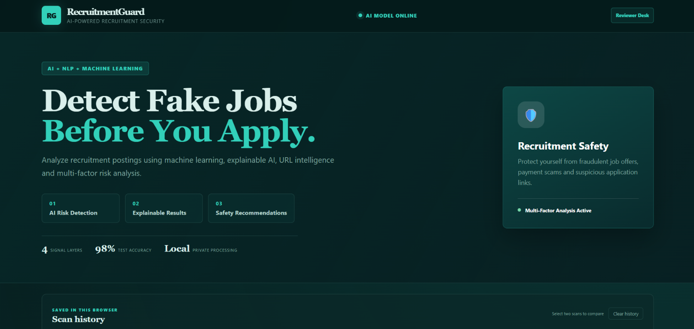
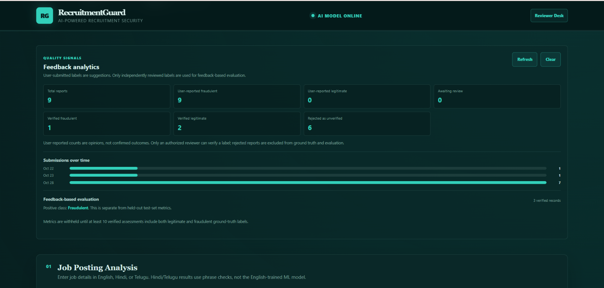
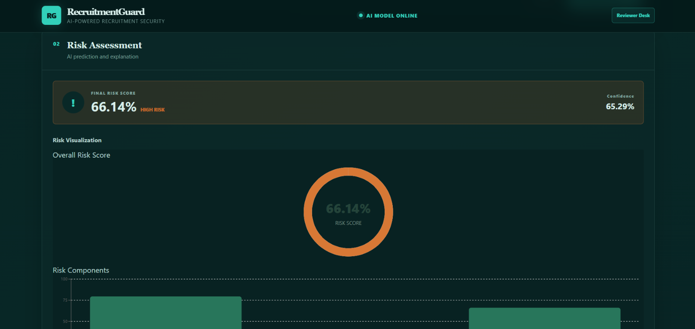
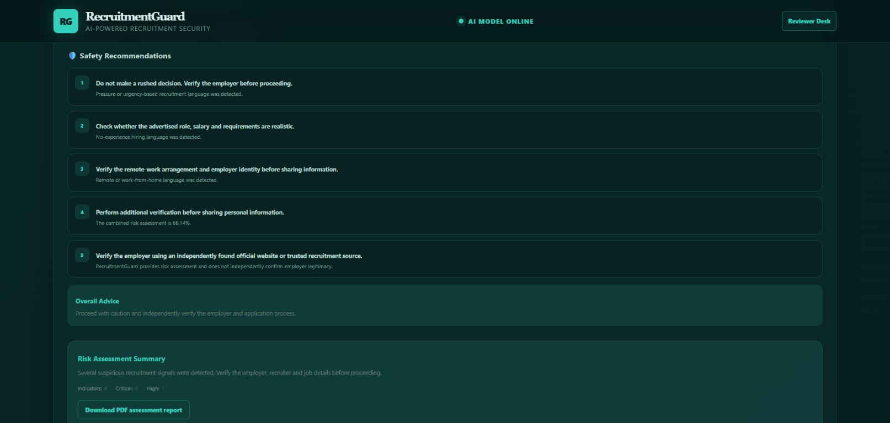
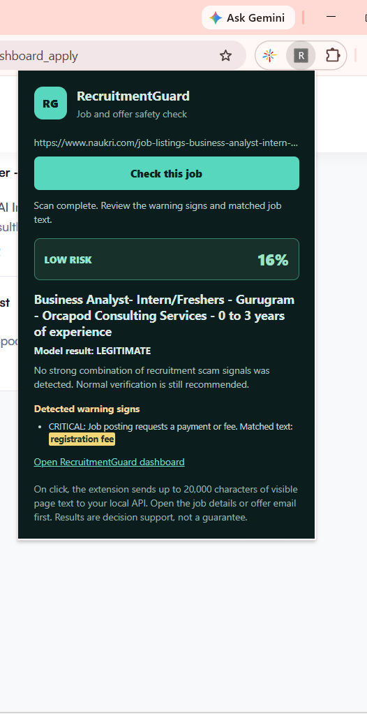

# RecruitmentGuard

<p align="center">
  <strong>AI-assisted recruitment scam detection with explainable risk signals.</strong>
  <br />
  Assess job postings, inspect warning signs, and make more informed decisions before you apply.
</p>

RecruitmentGuard combines a TF-IDF machine-learning model with rule-based indicators, URL intelligence, multi-factor risk scoring, and practical safety recommendations. It includes a web dashboard, a Chromium browser extension, batch analysis, and a reviewer workflow for evaluating user feedback.

<p align="center">
  <a href="https://recruitment-scam-detection.vercel.app/"><strong>Open the live RecruitmentGuard app →</strong></a>
  <br />
  <sub>Live dashboard hosted on Vercel · API hosted on Render</sub>
</p>

> **Important:** RecruitmentGuard is a decision-support tool, not a guarantee or independent verification of an employer. Always verify the employer and job offer through trusted sources.

## Contents

- [Highlights](#highlights)
- [Project screenshots](#project-screenshots)
- [How it works](#how-it-works)
- [Get started](#get-started)
- [Browser extension](#browser-extension)
- [Analysis features](#analysis-features)
- [Feedback and reviewer workflow](#feedback-and-reviewer-workflow)
- [Model evaluation](#model-evaluation)
- [Transformer research pipeline](#transformer-research-pipeline)
- [Render deployment](#render-deployment)
- [Railway deployment](#railway-deployment)
- [Docker deployment](#docker-deployment)
- [Privacy and security notes](#privacy-and-security-notes)

## Highlights

- **Explainable assessments:** see a risk level, score, model output, matched warning signs, and recommendations.
- **More than text classification:** combine model predictions with rule-based signals, URL findings, and employer/application-domain comparisons.
- **Flexible job analysis:** assess pasted details, images, PDFs, public job URLs, or CSV batches.
- **Browser-based checks:** scan the active job page with the Chromium extension when you choose to run it.
- **Reviewable feedback:** separate user-submitted labels from independently verified decisions; feedback never retrains the production model automatically.

### Best held-out accuracy: 98.90%

The TF-IDF Linear SVM achieved **98.90% accuracy** on the held-out test set of 2,647 job postings. This is the best individual model accuracy reported for the project, not a separate accuracy score for the entire application. See [Model evaluation](#model-evaluation) for results from all evaluated models.

## Project screenshots

<p align="center">
  
</p>

<table>
  <tr>
    <td width="50%" align="center">
      
      <br /><sub>Feedback analytics</sub>
    </td>
    <td width="50%" align="center">
      
      <br /><sub>Risk assessment</sub>
    </td>
  </tr>
  <tr>
    <td width="50%" align="center">
      
      <br /><sub>Safety recommendations</sub>
    </td>
    <td width="50%" align="center">
      
      <br /><sub>Browser extension</sub>
    </td>
  </tr>
</table>

## How it works

The project is organized around a Python API and a React dashboard. The API loads the trained model and supporting artifacts, analyzes job details, and returns a structured assessment. The dashboard presents that result and provides the scanning, reporting, batch-analysis, history, and reviewer interfaces. The Chromium extension sends visible text from the active tab to the hosted API only after the user starts a scan.

| Area | Location |
| --- | --- |
| API, risk analysis, and URL intelligence | `src/api/`, `src/risk_engine/`, `src/url_intelligence/` |
| Data, preprocessing, features, and models | `src/data/`, `src/preprocessing/`, `src/features/`, `src/models/` |
| Web dashboard | `frontend/` |
| Chromium extension | `extension/` |
| Datasets and evaluation outputs | `data/`, `results/`, `artifacts/` |
| Automated tests | `tests/` |

## Get started

### Prerequisites

- Python and Node.js/npm
- Windows PowerShell, or a terminal adapted to your operating system

### 1. Install Python dependencies

From the repository root:

```powershell
python -m venv .venv
.\.venv\Scripts\Activate.ps1
pip install -r requirements.txt
```

### 2. Start the API

In the repository root:

```powershell
python -m uvicorn src.api.app:app --host 127.0.0.1 --port 8000
```

The API health check is at `http://127.0.0.1:8000/health`; interactive API documentation is at `http://127.0.0.1:8000/docs`.

### 3. Start the dashboard

In a second terminal:

```powershell
cd frontend
npm install
npm run dev -- --host 127.0.0.1 --port 5174
```

Open `http://127.0.0.1:5174/`. During development, Vite proxies `/api` requests to `http://127.0.0.1:8000`. Set `VITE_API_URL` at build time if the API runs at a different address.

## Browser extension

### Download and install from GitHub

Download the [RecruitmentGuard Job Checker v1.1.0 ZIP](extension/downloads/recruitmentguard-chrome-extension-v1.1.0.zip) from this repository and extract it. In Chrome, open `chrome://extensions`, turn on **Developer mode**, click **Load unpacked**, and select the extracted folder containing `manifest.json`. Pin the extension from Chrome's Extensions menu, open a job details page, click the RecruitmentGuard icon, then choose **Check this job**.

This GitHub installation is free and does not require Chrome Web Store developer registration, but it is a manual developer-mode install: users download updates themselves, and Chrome may show a developer-mode notice. A Chrome Web Store listing is not available yet.

The extension reads up to 20,000 characters of visible text from the active tab after your click and sends the page URL, title, and text to the hosted API's `POST /scan-page-content` endpoint. It does not automatically scan, modify the page, or fetch the source website again. Inbox summaries may not contain enough job details. See [extension installation, privacy, and store listing information](extension/README.md) and the [privacy-policy draft](extension/PRIVACY_POLICY.md).

## Analysis features

### Job-post assessments

The dashboard accepts job details and supports image and PDF uploads. Browser OCR extracts text from images and scanned PDFs; text-based PDFs are read directly. Results include the model prediction, fraud probability when applicable, risk score and level, explainable feature contributions, risk indicators, URL findings, employer-domain comparison, and safety recommendations.

For each rule-based warning, the API provides the matched phrase in `evidence` and a surrounding excerpt in `evidence_context`. The dashboard highlights matched words, the extension shows warning evidence, and downloadable PDF reports include detected signs. These are matches in the supplied content, not independent confirmation that a claim or employer is fraudulent.

Use **Download PDF assessment report** after an assessment to save a report containing its prediction, score, confidence, warning signs, available URL findings, recommendations, and a decision-support disclaimer. PDF generation runs in the browser; report content is not uploaded for document generation.

### Job URL scanner

Use **Scan a public job posting URL** to fetch an accessible public job page, extract available JobPosting JSON-LD fields (with page-text fallback), populate the form, and run an assessment. Review extracted details before relying on them; login-gated or blocking sites may not scan successfully.

The API endpoint is `POST /scan-url`, with a request such as:

```json
{"url":"https://public.example/jobs/role"}
```

It returns `source_url`, `extracted_job`, and an `assessment` matching the regular `/predict` response. The scanner accepts only HTTP/HTTPS on standard ports, rejects private/local addresses, verifies the connected peer, blocks redirects to unsafe addresses, follows at most three redirects, accepts HTML only, and caps downloads at 2 MB. DNS resolution has a five-second deadline, and page connections use connect/read timeouts. Scan failures are explicit; an unscanned URL is not assigned a low-risk result, and DNS failure alone is not treated as fraud evidence.

For URL-only feature testing without fetching a site, use **URL-only test mode (no website fetch)** or call `POST /classify-url`:

```json
{"urls":["https://example.com/jobs/role"]}
```

This mode does not resolve DNS or request the page. Its prediction is based on the URL string alone, not the website's content or availability.

### Batch analysis

Upload a UTF-8 CSV using **Batch job analysis** to analyze up to 250 postings per request (maximum 1 MB). The dashboard provides a template. Common column aliases include `Job Title`, `Company Name`, `Job Description`, and `combined_text`; unknown fields are ignored. Invalid, missing, overlong, or malformed rows are reported individually.

Results summarize analyzed, invalid, HIGH/CRITICAL, and duplicate counts. Duplicate checks flag identical normalized postings, highly similar text, and moderately similar text sharing multiple high-risk warning categories. These are review cues—not proof of a shared author or fraud. Export all analyzed rows, high-risk rows, duplicate matches, or all rows including validation errors. Downloads quote CSV cells and neutralize spreadsheet formula prefixes.

### History and verification checklist

The dashboard stores up to 15 recent individual assessments and their job text in the current browser's local storage. History is not synced to the API and can be cleared in the dashboard. Select two saved scans to compare their risk level, score, prediction, warning-sign count, and scan time.

The result includes a checklist for independently verifying the employer, recruiter email, application domain, payment requests, and requests for sensitive information. Checklist progress is saved in this browser per job identity. Completing the checklist does not alter a score or guarantee that a job is legitimate.

### Language handling

Hindi and Telugu text written in Devanagari or Telugu script is checked against a limited set of recruitment warning phrases, including payment requests, urgency, and guaranteed earnings. Matching phrases are shown as evidence. The saved TF-IDF model was trained for English and is deliberately not run for detected Hindi/Telugu input: the response is `NEEDS_REVIEW`, risk scoring uses language-specific rule indicators only, and no ML fraud probability or confidence is reported. Romanized phrase matching is best-effort. This prototype is not a comprehensive translation or multilingual scam detector.

### API contract

`GET /health` confirms that the trained model and vectorizer are loaded. `POST /predict` accepts these optional text fields:

```json
{
  "title": "Software Engineer",
  "location": "Hyderabad / Remote",
  "company_profile": "Company information",
  "company_website": "https://company.com",
  "description": "Full job description",
  "requirements": "Skills and experience",
  "benefits": "Salary and benefits"
}
```

The optional `company_website` is compared with application-link domains. External links are informational and do not change the model risk score.

## Feedback and reviewer workflow

Each supported prediction receives an analysis ID. Users can submit a suggested fraudulent/legitimate label and an optional explanation. By default, the API stores the prediction label, fraud probability, final risk score, risk level, posting title, feedback label, explanation, timestamp, and review state in `data/feedback.sqlite3`; it does not store the full job posting. Existing databases receive a nullable `final_risk_score` column migration when opened. Repeat submissions for the same assessment return the original record.

Feedback remains pending until an authorized reviewer independently checks the posting. The dashboard's **Feedback Analytics** distinguishes user-submitted suggestions from verified fraudulent, verified legitimate, pending, and rejected reports. Feedback-based precision, recall, F1-score, and confusion matrix use only verified decisions and the original prediction for the assessment. Metrics are shown only when there are at least 10 verified records and both ground-truth classes. The positive class is **Fraudulent**. These metrics are separate from held-out test-set metrics.

### Configure reviewer access

Copy `.env.example` to `.env`, replace the placeholder admin key with a long random secret, and set it before starting the API:

```powershell
$env:RECRUITMENTGUARD_ADMIN_KEY = "use-a-long-random-secret"
$env:RECRUITMENTGUARD_REVIEWER_IDENTITY = "authorized-reviewer"
python -m uvicorn src.api.app:app --host 127.0.0.1 --port 8000
```

Authorized reviewers can use **Reviewer Desk** to inspect pending submissions and choose `VERIFIED_FRAUDULENT`, `VERIFIED_LEGITIMATE`, or `REJECTED`. Reviews record the configured reviewer identity and timestamp. Pending and rejected reports are excluded from evaluation metrics.

Protected API routes are also available:

- `GET /admin/feedback?review_status=PENDING`
- `POST /admin/feedback/{id}/review`
- `GET /admin/feedback/export` (verified examples only)

For example, using PowerShell:

```powershell
$headers = @{ "X-Admin-Key" = $env:RECRUITMENTGUARD_ADMIN_KEY }
Invoke-RestMethod -Headers $headers "http://127.0.0.1:8000/admin/feedback?review_status=PENDING"
Invoke-RestMethod -Method Post -Headers $headers -ContentType "application/json" `
  -Body '{"decision":"VERIFIED_FRAUDULENT","review_note":"Employer and offer independently verified."}' `
  "http://127.0.0.1:8000/admin/feedback/1/review"
```

The export contains verified labels and predictions for offline analysis; because full job text is not retained, it is not a ready-made retraining dataset. Feedback never retrains or replaces the production model. Preserve the original training data and model, evaluate candidate models on the held-out test set against the current baseline, and replace the production model only after it meets explicit acceptance criteria.

## Model evaluation

Evaluation scripts are in `src/evaluation/`. Run the full automated test suite:

```powershell
pytest -q
```

For focused URL-scanner and API regression coverage:

```powershell
pytest -q tests/test_job_page_scanner.py tests/test_job_url_api.py
```

Compare the saved Logistic Regression, Linear SVM, and multi-factor models on the held-out test split:

```powershell
python -m src.evaluation.evaluate_models
```

The report includes fraud recall, precision, specificity, F1, G-Mean, ROC-AUC, PR-AUC, class counts, and a confusion matrix. JSON and CSV outputs are written to `results/evaluation/`. Models without saved artifacts are explicitly skipped. Keep the test split held out until final comparisons; do not use it to tune model settings.

### Recorded held-out results

Evaluation was run on 2,647 held-out postings: 2,519 legitimate and 128 fraudulent.

| Model | Accuracy | Fraud recall | ROC-AUC | PR-AUC |
| --- | ---: | ---: | ---: | ---: |
| TF-IDF Logistic Regression | 98.04% | 86.72% | 0.9902 | 0.9134 |
| TF-IDF Linear SVM | 98.90% | 80.47% | 0.9895 | 0.9343 |
| Multi-Factor Logistic Regression | 97.58% | 87.50% | 0.9913 | 0.9127 |

On this split, the multi-factor model has the highest fraud recall and ROC-AUC, while the SVM has the highest accuracy and PR-AUC. Because the classes are imbalanced, accuracy alone can hide missed fraud. Report class distribution and multiple metrics when discussing performance.

## Transformer research pipeline

The optional training pipeline in `src/models/transformer_orf.py` supports `bert-base-uncased` and `roberta-base`. It mean-pools encoder embeddings, applies SMOTE in embedding space, trains a classifier, and reports accuracy, balanced accuracy, recall, sensitivity, specificity, F1-score, G-Mean, and a confusion matrix.

Install the project's dependencies, then run both comparisons:

```powershell
pip install -r requirements.txt
python src/models/transformer_orf.py --model both
```

To compare without oversampling:

```powershell
python src/models/transformer_orf.py --model both --no-smote
```

The first run downloads pretrained models. CUDA-enabled PyTorch and a GPU are recommended for practical training time; CPU execution is supported but slow. Outputs are saved under `artifacts/transformers/`. This pipeline uses the project's available recruitment dataset, not the paper's combined Pakistan/US/Fake Job dataset. Report its metrics as an extension, not as a reproduction of the paper's results.

## Docker deployment

Docker Compose starts the API and dashboard, persists the feedback database, and checks API health before starting the frontend. Copy `.env.example` to `.env` and set private reviewer credentials:

```dotenv
RECRUITMENTGUARD_ADMIN_KEY=replace-with-a-long-random-secret
RECRUITMENTGUARD_REVIEWER_IDENTITY=authorized-reviewer
```

Build and start the services:

```powershell
docker compose up --build
```

Open the dashboard at `http://127.0.0.1:8080/`. The API and interactive docs are at `http://127.0.0.1:8000/` and `http://127.0.0.1:8000/docs`.

## Render deployment

The root [render.yaml](render.yaml) Blueprint defines an API web service and a static dashboard, both on Render's free plan where available. It connects the dashboard's `VITE_API_URL` to the API host and allows requests from the dashboard's exact Render origin. The admin key is generated by Render and is not stored in this repository.

1. Sign in to the [Render Dashboard](https://dashboard.render.com/) and connect GitHub access to `ChinthaVarshini/Recruitment-Scam-Detection`.
2. Choose **New → Blueprint**, select this repository and its `main` branch, then review and apply the services defined in `render.yaml`.
3. Wait for the API and dashboard deployments to finish. Open the dashboard service's `onrender.com` URL and check that the dashboard loads and can reach the API.
4. To access the Reviewer Desk, copy the generated `RECRUITMENTGUARD_ADMIN_KEY` from the API service's private environment settings and enter it in the dashboard. Never publish or commit this key.

The free API service can spin down when idle, so its first request may take about a minute. Free services do not have persistent disks, so SQLite feedback data may be lost on restart or redeploy. For persistent feedback storage, upgrade the API to a paid plan, attach a disk mounted at `/var/data`, and set `RECRUITMENTGUARD_FEEDBACK_DB=/var/data/feedback.sqlite3`. Review Render's current [free instance limitations](https://render.com/docs/free) and [disk options](https://render.com/docs/disks).

## Railway deployment

Railway deploys the API and dashboard as separate services from this repository. The frontend proxies `/api` requests to the API over Railway's private network, so only the dashboard needs a public domain. Railway's [monorepo guide](https://docs.railway.com/deployments/monorepo) describes configuring a separate root directory for each service.

1. In Railway, create a project and add a service from the GitHub repository `ChinthaVarshini/Recruitment-Scam-Detection`. Name this service **api** and leave its root directory at `/`, so Railway uses the root `Dockerfile`.
2. In the API service variables, set:

   ```text
   PORT=8000
   RECRUITMENTGUARD_ADMIN_KEY=<a long, unique secret>
   RECRUITMENTGUARD_REVIEWER_IDENTITY=authorized-reviewer
   RECRUITMENTGUARD_FEEDBACK_DB=/app/feedback-data/feedback.sqlite3
   RAILWAY_RUN_UID=0
   ```

   Generate the admin key privately and add it in Railway's Variables settings; do not commit it or share it in chat. Railway mounts volumes as root-owned, so `RAILWAY_RUN_UID=0` lets the API write to its feedback volume.
3. Add a Railway volume to the API service and set its mount path to `/app/feedback-data`. This preserves feedback records across deployments.
4. Add a second service from the same GitHub repository and name it **frontend**. Set its root directory to `/frontend`, so Railway builds `frontend/Dockerfile`.
5. In the frontend service variables, set `API_HOST=api.railway.internal` and `API_PORT=8000`. The frontend image uses Railway's `PORT` variable for its Nginx listener.
6. Deploy both services. In the frontend service's **Settings → Networking**, generate a public domain. The API can remain private; the browser reaches it through the frontend proxy.

The API Docker image provides a `/health` health check. After deployment, open the frontend's Railway domain and confirm the dashboard loads and a scan completes. See Railway's documentation for [services](https://docs.railway.com/services), [private networking](https://docs.railway.com/networking/private-networking), [volumes](https://docs.railway.com/volumes), and [public domains](https://docs.railway.com/networking/public-networking). Review Railway's current pricing and limits before publishing.

## Privacy and security notes

- Keep `.env` and reviewer credentials private.
- The browser extension sends page text only after you click **Check this job**; it sends content over HTTPS to the RecruitmentGuard API, not back to the source website. The backend stores limited assessment metadata for supported predictions, but the scan route does not persist the full page text or source URL.
- Scan history is stored in the current browser's local storage. Feedback stores assessment metadata and does not retain the full job posting by default.
- URL scanning has network-safety limits, but inaccessible pages may fail to scan.
- The included Docker Compose setup is a deployment baseline, not a complete public-internet security configuration. Use HTTPS, restrictive network access, and managed secrets before exposing it beyond a trusted environment.
- A low score does not guarantee that a job is safe. Independently verify the employer and never pay recruitment fees.
